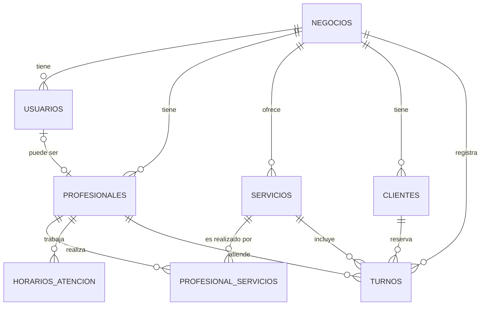

# 📅 Sistema de Turnos

Sistema web para que negocios de servicios (consultorios, estudios de estética, peluquerías) gestionen su agenda y sus clientes puedan reservar turnos online.

> 🌐 **Demo:** [reservar un turno](https://sistema-turnos-xh4s.onrender.com/reservar/consultorio-salud-integral)
>
> El [panel de administración](https://sistema-turnos-xh4s.onrender.com/login) requiere una cuenta.
>
> ⏳ Corre en un plan gratuito: la primera visita puede tardar cerca de 1 minuto.

## ✨ Funcionalidades

- [x] Login de usuarios (dueño / empleado)
- [ ] Registro de negocios desde la app
- [x] Gestión de servicios (duración y precio)
- [x] Gestión de profesionales y sus horarios de atención
- [x] Cálculo de horarios disponibles
- [x] Página pública de reservas para clientes
- [x] Panel de agenda para el negocio
- [x] Multi-negocio: varios negocios usan el mismo sistema con datos aislados

## 🛠️ Tecnologías

| Capa | Tecnología |
|---|---|
| Frontend | Vue 3, TypeScript, Vite, Vue Router, Pinia |
| Backend | Node.js, Express, TypeScript |
| Base de datos | PostgreSQL 16 |
| Infraestructura | Docker Compose (local), Render y Neon (producción) |

## 🗂️ Estructura

```
sistema-turnos/
├── backend/            API REST (Express + TypeScript)
│   ├── migrations/     Scripts SQL que crean la base de datos
│   ├── seeds/          Datos de prueba
│   └── src/
├── frontend/           Aplicación web (Vue 3)
└── docker-compose.yml  Base de datos PostgreSQL
```

## 🚀 Cómo correrlo localmente

### Requisitos
- Node.js 24 o superior
- Docker Desktop
- Git

### 1. Clonar el repositorio
```bash
git clone https://github.com/CamilaFigue/sistema-turnos.git
cd sistema-turnos
```

### 2. Levantar la base de datos
```bash
docker compose up -d
docker exec -i turnos_db psql -U turnos -d turnos -v ON_ERROR_STOP=1 < backend/migrations/001_esquema_inicial.sql
docker exec -i turnos_db psql -U turnos -d turnos -v ON_ERROR_STOP=1 < backend/migrations/002_turnos_sin_superposicion.sql
docker exec -i turnos_db psql -U turnos -d turnos -v ON_ERROR_STOP=1 < backend/migrations/003_turnos_confirmados.sql
docker exec -i turnos_db psql -U turnos -d turnos -v ON_ERROR_STOP=1 < backend/seeds/001_datos_prueba.sql
docker exec -i turnos_db psql -U turnos -d turnos -v ON_ERROR_STOP=1 < backend/seeds/002_passwords_demo.sql
```

### 3. Backend
```bash
cd backend
cp .env.example .env
npm install
npm run dev
```
API disponible en `http://localhost:3000` (verificar en `/api/health`).

### 4. Frontend
```bash
cd frontend
npm install
npm run dev
```
App disponible en `http://localhost:5173`.

### Usuario de prueba (solo para la instalación local)
- Email: `laura@consultorio.test`
- Contraseña: `demo1234`

## 🧩 Modelo de datos



## 🔜 Mejoras posibles
- Registro de negocios desde la app
- Límite de peticiones en el login y las reservas públicas
- Confirmación de turnos por WhatsApp o email

## 👩‍💻 Autora

**Camila Figueroa** · [LinkedIn](https://www.linkedin.com/in/cami-figueroa) · [GitHub](https://github.com/CamilaFigue)