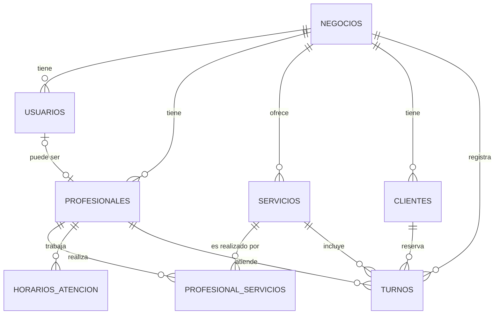

# 📅 Sistema de Turnos

Sistema web para que negocios de servicios (peluquerías, consultorios, estudios de estética) gestionen su agenda y sus clientes puedan reservar turnos online.

> 🚧 **Estado:** en desarrollo

## ✨ Funcionalidades

- [ ] Registro de negocios y login de usuarios (dueño / empleado)
- [ ] Gestión de servicios (duración y precio)
- [ ] Gestión de profesionales y sus horarios de atención
- [ ] Cálculo de horarios disponibles
- [ ] Página pública de reservas para clientes
- [ ] Panel de agenda para el negocio
- [ ] Multi-negocio: varios negocios usan el mismo sistema con datos aislados

## 🛠️ Tecnologías

| Capa | Tecnología |
|---|---|
| Frontend | Vue 3, TypeScript, Vite, Vue Router, Pinia |
| Backend | Node.js, Express, TypeScript |
| Base de datos | PostgreSQL 16 |
| Infraestructura | Docker Compose |

## 🗂️ Estructura

```
sistema-turnos/
├── backend/            API REST (Express + TypeScript)
│   ├── migrations/     Scripts SQL que crean la base de datos
│   ├── seeds/          Datos de prueba
│   └── src/
├── frontend/           Aplicación web (Vue 3)
└── docker-compose.yml  Base de datos PostgreSQL
```

## 🚀 Cómo correrlo localmente

### Requisitos
- Node.js 24 o superior
- Docker Desktop
- Git

### 1. Clonar el repositorio
```bash
git clone https://github.com/CamilaFigue/sistema-turnos.git
cd sistema-turnos
```

### 2. Levantar la base de datos
```bash
docker compose up -d
docker exec -i turnos_db psql -U turnos -d turnos -v ON_ERROR_STOP=1 < backend/migrations/001_esquema_inicial.sql
docker exec -i turnos_db psql -U turnos -d turnos -v ON_ERROR_STOP=1 < backend/seeds/001_datos_prueba.sql
docker exec -i turnos_db psql -U turnos -d turnos -v ON_ERROR_STOP=1 < backend/migrations/002_turnos_sin_superposicion.sql
```

### 3. Backend
```bash
cd backend
cp .env.example .env
npm install
npm run dev
```
API disponible en `http://localhost:3000` (verificar en `/api/health`).

### 4. Frontend
```bash
cd frontend
npm install
npm run dev
```
App disponible en `http://localhost:5173`.

## 🧩 Modelo de datos



## 👩‍💻 Autora

**Camila Figueroa** · [LinkedIn](https://www.linkedin.com/in/cami-figueroa) · [GitHub](https://github.com/CamilaFigue)